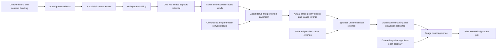

# Classical/external route for the first ver503 torus pair

Authorized by the human on 2026-10-09. The primary result is now an explicit conditional construction theorem, `exists_noncongruent_isometric_tight_tori_pair_of_classical (background : ClassicalExternalResults) (reparamBackground : ClassicalEmbeddedImageReparametrizationClaim) (ellipseAxesRecognition : MarkerEllipseAxesRecognition)`. Its conclusion remains two actual smooth embedded tight tori with the same positive smooth induced metric, noncongruent images, open agreement and no open planar patches.

The authoritative integration checkout is `C:/Users/gzhan/Documents/ChatGPT/tight_another_review/ver503-integration`. Its [generated precise blueprint](interfaces.md), [classical registry](../classical-external-results.json), [typed external statements](../TightVer401/ClassicalExternal.lean), and [same-object positive Gauss interface](../TightVer401/ClassicalExternalApplications.lean) define this route. Main's older kernel certificate is a separate source snapshot and is not a certificate of integration edits.

## Trust boundary

- **Kernel proved**: actual audited OpenAI/Mathlib/engine declarations, including actual annular degree, smoothing, meridian/convex geometry and the retained band/bending (new integrations require their own combined audit).
- **Externally granted**: the precise two statements in `ClassicalExternalResults`. A checked Prop definition is not a proof of its truth. There is no asserted inhabitant, new axiom or hidden sorry.
- **Kernel-checked conditional application**: a theorem with the explicit classical parameter. Its downstream claims must report that dependency.
- **Original construction pending**: selected source/core geometry, incoming rebase/open germs, ordinary connector-data family and final first-pair assembly; checked downstream filling/saddle/torus/marking consumers are retained. No classical grant can substitute for these objects.

Further missing classical/published theorems are authorized on demand: identify the exact statement, source, hypotheses and final-proof consumer in the registry. Prefer the pinned OpenAI/Mathlib/engine proof whenever it is already available. Do not create an assumed data package containing our desired construction.

## Main construction chain

Degree and relative smoothing are existing shared producers used by connectors/filling, not fresh construction projects. The convex meridian is selected once from RN,mu,h and retained in all torus/marking consumers. Source support G, actual gradient and inverse, protected field Y, compact support K and quotient phase placement must remain the same witnesses through all stages.

## Exact background and application obligations

1. **Positive-Gauss criterion**: Banchoff–Kühnel §1.1, pp.56–57, Gauss-area formula and positive-curvature equality characterization. From an actual compact smooth embedded torus, actual global smooth unit normal, and a genuine smooth Gauss inverse whose source is exactly the entire intrinsic K>0 region and target is the sphere minus finitely many points, infer the existing half-space `IsTightImage`. Transport/root must construct every input. Saddle negative curvature and both zero-curvature seams are needed to identify that ENTIRE locus. No positive-area or tightness conclusion is a producer input.
2. **Equal-image fixed-open corollary**: smooth embedded-submanifold inversion plus connected Riemannian isometry rigidity. Two smooth embedded immersions on the same source with pointwise equal actual induced forms, identical entire images, and a nonempty open agreement region are equal maps. Degree must apply this only AFTER actual marking turns an alleged ambient congruence into identity, and contradict the actual nonzero field at nonzero amplitude.

[Banchoff–Kühnel](https://library.slmath.org/books/Book32/files/banchoff.pdf), [Cohen's embedded-submanifold reference](https://math.stanford.edu/~ralph/math215b/book.pdf), and retained `FixedOpenCompact.lean` identify the background. These are generic corollaries, not claims that those sources construct our torus.

A general surface-area/Gauss–Bonnet library, broad height-maxima/component topology and native intrinsic-distance instance packaging are **parked, nonblocking alternatives**. Existing compiled proofs are preserved. The optional numerical 8π manuscript assertions are separately pending until an actual integral interface/application is checked. Affine half-space transport, actual curvature signs, metric positivity/smoothness and no open planar patches remain explicit applications.

## Fresh ver503 construction owners

The authoritative integration worktree is recorded by COORDINATION.md at the repository root. Historical certificates are provenance only. Current workers consume frozen current-source exports and keep one compiler writer per worktree.

1. Selected source/core geometry: actual strict source nesting, protected band placement, original-potential agreement, using reviewed signed-order exports. Consumer: exists_markedTorus_pair_of_negative_gradient_order, then root ultimate theorem.
2. Incoming rebase/seam: actual matching values/gradients, SAME inverse phase/height/source, displaced seam and terminal geometry, eta-first/rho-second compatible bounds. Consumer: worker3 relative-smoothing inputs and worker4 ordinary data.
3. Relative smoothing: final H on full fixed V with both open germs and negative Hessian on required closed band; prove on_sides actual domain/containment hypotheses. Consumer: worker4 ordinary scalar fields and final H gradient inverse.
4. Ordinary connector data: one actual VisibleConnectorWitnessAssemblyOrdinaryData family, combining signed-order/terminal/native/source producers and workers1–3. Consumer: exists_dual_radial_support_completion_of_ordinary_connector_data and exists_markedTorus_pair_of_ordinary_connector_data.

Root owns frozen interfaces, integration/fixes, current-source audit and ultimate exists_noncongruent_isometric_tight_tori_pair_of_classical. Preserve SAME corrected seed, clocks, protected field, selected graphs, support potential, completed scalar tuple and once-chosen full meridian. Native inverse e and Cartesian E are distinct. Final smoothed H gets its own gradient inverse.

Registered external premises remain four exact named statements; they grant no original construction. No custom axioms or admissions in certified closure. Pending IncomingGin5176081 is separately preserved without proof credit. Extension/Cantor and broad alternative infrastructure stay deferred.
