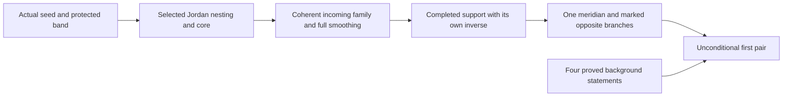

# Noncongruent isometric tight tori formalization report

Lean proves the existence of two noncongruent smooth embedded tight tori in Euclidean three-space with the same smooth positive induced metric. They agree on a nonempty open set, and neither has an open planar patch. The canonical theorem has **no background or construction premises**. All four formerly assumed background propositions now have closed proofs.

This completes the first assertion of `thm:main-fiber` in the exact ver503 manuscript, **An embedded band foliated by closed asymptotic lines and nonrigid smooth tight tori**. The whole manuscript remains incomplete: its Cantor-family, numerical total-curvature, orbit-space and extension assertions are outside this completed result. The [coverage register](coverage.json) records 17 proved numbered statements, three partial statements and 20 pending statements among 40; these counts are not a completion percentage for the first-pair construction.

## The checked torus pair

The public theorem is [`TightVer401.exists_noncongruent_isometric_tight_tori_pair`](TightVer401/NonrigidTorusPair.lean). Its source is the standard smooth product of two period circles, representing the torus. It returns actual maps `Xplus` and `Xminus`, a common smooth Riemannian metric `g`, and a nonempty open set `V`. Both maps are smooth embeddings and immersions; `g` equals both actual induced forms; no affine Euclidean isometry carries one entire image to the other; the maps agree on `V`; and no nonempty open source subset maps into an affine plane.

Here tightness is the exact predicate [`IsTightImage`](TightVer401/TorusGoalObjects.lean): every intersection of the image with an open affine halfspace is preconnected. A nonempty such intersection is connected. The theorem does not assert a numerical curvature integral or a continuous family of realizations.

The construction uses one corrected periodic seed, one final protected nonzero bending field, the selected source curves and support potential, one completed scalar tuple and one full convex meridian. The two maps are the same affine marked base plus and minus the same small bending. Their open agreement set is the complement of the same transported support. The native Gauss inverse, raw Cartesian source inverse and final smoothed potential's own gradient inverse remain distinct objects.



The premise-free seed producer is `actualSeed_exists_selected_single_prefix`. The universal producer `visibleConnectorOrdinaryFamily_nonempty_from_incoming` takes arbitrary actual incoming data and a positive parameter budget, then constructs the coherent connector data. It chooses the displacement before the final strip width, retains the full incoming germ, constructs one potential on the full domain with both genuine open boundary germs and a negative Hessian determinant throughout the closed band, and supplies the actual downstream completion. These are constructions, not hypotheses granting the desired filling or torus. Their exact interfaces are in the [blueprint](blueprint/interfaces.md).

## Four background propositions now proved

All names in this section belong to `TightVer401`.

| Proposition | Closed proof | Main argument |
|---|---|---|
| Smooth reparametrization of equal-image embeddings | [`classicalEmbeddedImageReparametrization_proved`](TightVer401/ClassicalEmbeddedReparamProof.lean) | Range homeomorphisms and recovery of smoothness through an injective differential, using a linear left inverse and the inverse function theorem |
| Recognition of unequal ellipse axes | [`markerEllipseAxesRecognition_proved`](TightVer401/MarkerEllipseAxesRecognitionProof.lean) | The center and longest-axis endpoints determine the axes; preservation of norms and inner products determines the coordinate signs |
| Equal-image embeddings with equal induced forms and open agreement coincide | [`classicalCoincidentEmbeddingFixedOpen_proved`](TightVer401/ClassicalCoincidentEmbeddingFixedOpenProof.lean) | The reparametrization preserves actual tangent norms and intrinsic path distance; compact fixed-open isometry rigidity forces it to be the identity |
| A one-sheeted positive-curvature Gauss chart implies tightness | [`classicalPositiveGaussTightness_proved`](TightVer401/ClassicalPositiveGaussTightnessProof.lean) | Sard regular directions, actual curvature at height maxima, one normal sign on the connected positive region, unique maxima and connected superlevels |

The Gauss criterion concerns an arbitrary actual native torus embedding and actual smooth orthogonal unit normal. The Gauss chart's source is the **entire actual positive-curvature region**, and its target is the sphere minus finitely many points. Both normal signs are handled in one regular-value argument. Continuity of the actual second fundamental form fixes the sign at maxima; Gauss injectivity then makes the maximum unique. Compact component topology connects strict superlevels, and approximation extends the result to every direction. No outward-normal convention, zero-curvature area condition, area formula or Gauss–Bonnet grant is added.

The rigidity proof uses the genuine immersion-induced Riemannian metric and its C¹-path distance infimum, retaining the original topology. It does not substitute an ambient chord distance or the original product-circle distance.

[`classicalExternalResults_proved`](TightVer401/ClassicalExternalProof.lean) also supplies a closed inhabitant of the retained two-field geometric bundle. The [registry](classical-external-results.json) contains four proved background entries and **no grants**. Conditional consumers remain available for reuse; the canonical pair theorem supplies their proved inputs internally.

## General infrastructure useful beyond this construction

The most immediate contributions to Lean are small results whose types contain no torus seed, connector or marked-pair data. They apply to arbitrary spaces, functions or manifolds. “Project proof” below means an implementation in this repository, not a claim of new mathematics or upstream acceptance.

| Result and source | General hypotheses | Why it matters |
|---|---|---|
| [`classicalEmbedding_contDiffAt_factor`](TightVer401/ClassicalEmbeddingSmoothFactor.lean) | Complete real normed outer domain, finite-dimensional outer target, normed factor domain; smooth outer map with injective differential, continuous factor and smooth composition | Recovers smoothness through an immersion without requiring a prepackaged global embedding or immersion structure |
| [`localMax_fderiv_fderiv_apply_nonpos`](TightVer401/LocalMaxSecondDerivative.lean) | A real normed space, a local maximum and C² regularity at the point | Gives the necessary Hessian test in every direction, useful in optimization and variational arguments |
| [`height_superlevel_isPreconnected_of_uniform_approximants`](TightVer401/HeightSuperlevelLimits.lean) | Any topological space; arbitrarily close uniform approximants whose strict superlevels are preconnected | Transfers connectedness of all strict superlevels without assuming continuity or compactness |
| [`height_superlevel_isPreconnected_of_unique_localMax`](TightVer401/HeightSuperlevelConnected.lean) | A compact locally connected space and a continuous real function with at most one local maximum | Converts local information about maxima into global connectedness of every strict superlevel |
| [`riemannianEDist_homeomorph_eq_of_tangent_enorm`](TightVer401/NativeEmbeddingMetricIsometryDistance.lean) | A C¹ homeomorphism with C¹ inverse preserving actual Riemannian tangent norms | Connects differential isometries to intrinsic distance isometries without compactness, connectedness or completeness assumptions |
| [`connected_emetric_edist_ne_top`](TightVer401/NativeEmbeddingMetricIsometrySpace.lean) | A preconnected pseudo-emetric space | Shows that every extended distance is finite, helping pass from extended metrics to ordinary metrics |

The scalar companion `localMax_deriv_deriv_nonpos` needs continuity and a local maximum, using Lean's total derivative convention. The component lemma `height_superlevel_component_exists_localMax` supplies the key compactness argument. The intrinsic-distance package also proves a map inequality from tangent-norm preservation. Its finite metric-space and topology declarations compose existing Mathlib constructors; the finiteness and path-distance transport proofs are the substantive additions.

A search of the **pinned** Mathlib revision did not surface equivalent exports for the first five results. This does not establish absence from current upstream. The smooth-factor theorem is especially useful alongside the pinned immersion API, where the injective-differential-to-immersion bridge remains unfinished.

## Larger reusable packages

The project also provides substantial packages with geometric or periodic hypotheses that still apply beyond the chosen seed.

| Package | Useful interface | Scope retained in the theorem |
|---|---|---|
| Smooth moment controls | [`MomentControlBump`](TightVer401/MomentControlBump.lean), [`MomentControlBasis`](TightVer401/MomentControlBasis.lean) | Vector integral error estimates, shrinking normalized bumps, and independent moments from disjoint short controls avoiding a protected point |
| Exact nonlinear period prescription | [`finite_moment_period_prescription`](TightVer401/MomentPrescription.lean) | Positive smooth periodic perturbations preserve finite vector moments, prescribe a square-root period response, and have arbitrarily small L¹ change and short support |
| Scalar ODE and return calculations | [`scalarLinearODE_endpoint`](TightVer401/ScalarFlowVariationLinearODE.lean), [`riccati_solutions_unique`](TightVer401/RiccatiUniqueness.lean), [`RiccatiFlow`](TightVer401/RiccatiFlow.lean) | Compact-interval integrating factors, uniqueness and an explicit small-data Möbius return; not a general vector ODE existence package |
| Periodic signs and embedding stability | [`PeriodicDerivativeSigns`](TightVer401/PeriodicDerivativeSigns.lean), [`CurveL1Stability`](TightVer401/CurveL1Stability.lean) | Nonconstant periodic functions have derivative values of both signs; curve stability keeps the direction field fixed and speeds positive |
| Global annular inversion | [`annular_degree_global_diffeomorphism`](TightVer401/AnnularDegree.lean) | Genuine nested Jordan annuli, boundary homeomorphisms, a nonzero Jacobian of fixed sign and actual angular degree data |
| Support and Legendre geometry | [`SphereSupportCurvature`](TightVer401/SphereSupportCurvature.lean), [`GnomonicTensor`](TightVer401/GnomonicTensor.lean), [`PlanarLegendre`](TightVer401/PlanarLegendre.lean) | Actual differentials, induced forms, curvature and reciprocal Hessian identities on the specified charts and gradient inverse domains |
| Ruled geometry and relative smoothing | [`GeneralRuledReturnTheorem`](TightVer401/GeneralRuledReturnTheorem.lean), [`RuledKernelTheorem`](TightVer401/RuledKernelTheorem.lean), [`RelativeSaddleSmoothing`](TightVer401/RelativeSaddleSmoothing.lean) | Actual frame regularity, return conditions, supported bendings, matching seam jets and quantitative saddle-sign hypotheses |

The moment packages are useful for smooth perturbations subject to finitely many integral constraints. The ODE packages expose exact endpoint and return behavior. The annular and support packages connect local calculus to global geometric inverses. Relative smoothing preserves prescribed germs while controlling the Hessian sign. Their usefulness comes from these reusable interfaces; none asserts the same conclusion for arbitrary data without its stated hypotheses.

The generic regular-value adapters in [`GaussTightnessRegularValues`](TightVer401/GaussTightnessRegularValues.lean) use the existing Mathlib Sard theorem. They select regular values for countable families of maps on actual differentiability domains. The sphere-direction and local curvature adapters reuse these results. This project does not claim a new formalization of Sard's theorem.

## Manuscript statements formalized

The following complete numbered statements are recorded as proved under their reviewed hypotheses. Representative exports are abbreviated by omitting the `TightVer401` prefix; the [coverage register](coverage.json) and [Lean map](blueprint/lean-map.json) give the remaining exports and bindings.

| Reviewed statement | Manuscript label | Representative Lean export |
|---|---|---|
| [Support reconstruction](../paper/paper.tex#L470) | `prop:support` | `sphere_gauss_decomposition` |
| [Annular degree criterion](../paper/paper.tex#L551) | `lem:degree` | `annular_degree_global_diffeomorphism` |
| [Supported kernel on a ruled band](../paper/paper.tex#L697) | `thm:ruled` | `ruled_supported_kernel` |
| [Finite-moment period prescription](../paper/paper.tex#L882) | `lem:finite-moment-balance` | `finite_moment_period_prescription` |
| [Normal-loop existence criterion](../paper/paper.tex#L925) | `thm:normal-loop-criterion` | `normalLoop_existence_criterion` |
| [Relative upgrade of an embedded seed](../paper/paper.tex#L973) | `cor:relative-holonomy-upgrade` | `normalLoop_relative_holonomy_upgrade` |
| [Corrugated analytic seed](../paper/paper.tex#L1064) | `lem:seed` | `corrugated_analytic_seed` |
| [One-slowdown holonomy correction](../paper/paper.tex#L1193) | `prop:one-slowdown` | `one_slowdown_holonomy_correction` |
| [Balanced embedded speed](../paper/paper.tex#L1210) | `thm:spike` | `corrugatedSeed_exists_balanced_embedded_speed` |
| [Central support tensor](../paper/paper.tex#L1273) | `prop:central-support` | `identityBand_central_support_tensor` |
| [Relative saddle smoothing](../paper/paper.tex#L1439) | `lem:smoothing` | `exists_relative_saddle_smoothing` |
| [Quadratic filling at a circular seam](../paper/paper.tex#L1607) | `lem:quadratic-filling` | `exists_quadratic_radial_filling` |
| [Square-root neck adapter](../paper/paper.tex#L1682) | `lem:neck-adapter` | `dualRadialNeck_actual_first_jet` |
| [Convex closure](../paper/paper.tex#L1988) | `lem:convex` | `exists_parabolic_convex_closure` |
| [Disjoint quadratic branching](../paper/paper.tex#L2194) | `thm:branch` | `Manifold.finite_sign_metric` |
| [Strictly convex continuation of a radial profile](../paper/paper.tex#L2468) | `lem:complete-profile` | `exists_completeProfile` |
| [Riccati return and a two-jet criterion](../paper/paper.tex#L2586) | `prop:general-ruled-return` | `general_ruled_return` |

The unconditional first-pair theorem is an additional completed assertion within `thm:main-fiber`. The whole numbered statement remains pending because it also contains the Cantor family, common agreement across that family, numerical total absolute curvature 8π, and a topological embedding into the quotient of embeddings by Euclidean isometries.

Three labels are partial. `prop:budget` has actual local curvature preservation and stability results, but not the numerical absolute-curvature integral. `lem:fixed-open` has the compact connected boundaryless smooth Riemannian case and the exact embedding corollary; broader noncompact, boundary and automatic-smoothness variants remain outside that credit. `thm:localized-sign` has metric identities for an already smoothly convergent series and coefficient injectivity, but does not construct the Cantor embedding family or its quotient topology.

The general Codazzi/period criterion, product-holonomy equivalence, geometric multiplier formula, complete proper saddle cylinder, broader ruled kernel and visible-partner statements remain pending. Linking, Han–Khuri and fixed-boundary applications are deferred. Constructed instances sufficient for the first pair do not automatically prove every broader exit, connector, completion or marking statement.

## Papers and foundations

The formalized paper target is the exact **ver503 manuscript**, with the scope just described. No entire additional external paper or textbook is claimed as formalized. The proved background statements are targeted formulations of classical embedding, rigidity, ellipse and tightness facts; their contextual references remain in the registry.

Mathlib supplies inherited topology, linear algebra, calculus, bumps, integration, inverse functions, Sard and Riemannian path-distance machinery. Selected pinned OpenAI/math and Schoenflies sources supply inherited Jordan/Green, sphere, immersion-curvature, periodic primitive and geodesic foundations. The project contributes the indicated proofs, constructions and adapters on top of these libraries. Local inverse wrappers, metric constructors and atlas transport are distinguished from new project proof arguments.

## Organization and opportunities for Lean

The new [`TightVer401.Library`](TightVer401/Library.lean) groups exports into Calculus, Topology, Analysis, Riemannian, DifferentialGeometry and Construction. The [library catalog](TightVer401/Library/README.md) describes their hypotheses and usage. Individual groups expose useful interfaces without importing the final construction. Existing source files, declaration names, namespace and dependency pins are preserved.

The strongest small extraction candidates are smooth factor recovery, the necessary Hessian test, the two superlevel theorems and intrinsic-distance transport. Standard namespaces, minimal imports, duplicate checks and generalizations to finite differentiability or maps between different manifolds would make them easier to maintain upstream. Bump estimates and scalar ODE results are the next manageable packages; moment prescription, annular degree and smoothing require more dependency separation.

These checked sources and public entry points are available now. Upstream submissions and acceptance are future work. Their value for Lean is broader than differential geometry: abstract topological hypotheses, normed-space calculus, constrained analysis and intrinsic metric arguments allow reuse without recreating this torus construction.

## Verification and reproduction

The full current-source audit passed on **2026-10-09 at 20:30:18 UTC**, source commit **`a733b93d31cf80a2b2a4d3654890029cbe200b69`**. It checked 1,536 modules and 18,332 declarations, including 8,704 declarations in the project namespace. These include inherited results, helper lemmas, definitions and generated declarations; they are not counts of distinct published theorems.

The [snapshot](audit/snapshot.json) and [kernel report](audit/kernel-report.json) bind exact sources, compiled compatibility sources, dependency and object hashes, registry, coverage and toolchain. All four closed background types and the closed bundle are checked. The kernel directly verifies that the canonical theorem starts with an existential and has exactly the complete result type obtained by supplying the proved Gauss criterion to the retained conditional helper. Its certificate records `unconditional_pair_conclusion_checked: true`.

The certified closure has no admissions or custom axioms. Its permitted logical principles are `propext`, `Classical.choice` and `Quot.sound`. Historical pending IncomingGin drafts remain outside that closure. Kernel checking certifies the Lean formulations; the separate manuscript register records their reviewed mathematical scope.

Pins remain Lean **4.33.0-rc1**, Mathlib **`e4c91783ca8e6a7c693ae624ade32fd22d4e43c1`**, OpenAI/math **`adc7f1241b42e322a6451854ab7e4b4c146bf78a`**, and Schoenflies **`05a43d29cde026618777db3d4e4316204ccca237`**. The recorded source-compatibility profile is part of reproduction; use the supplied builder rather than assuming a plain Lake build applies those adaptations.

From `lean`, with the pinned dependencies configured:

```sh
python scripts/verify.py --jobs 3
python scripts/build_blueprint.py
```

For a focused library entry point:

```sh
python scripts/build.py --module TightVer401.Library.Calculus --jobs 3
```

The [engine README](README.md) and [worktree instructions](../SESSION_WORKTREES.md) give setup details. Each compiler writes private outputs; source edits require current validation. Numerical visualizations illustrate the construction and are not proof evidence.
